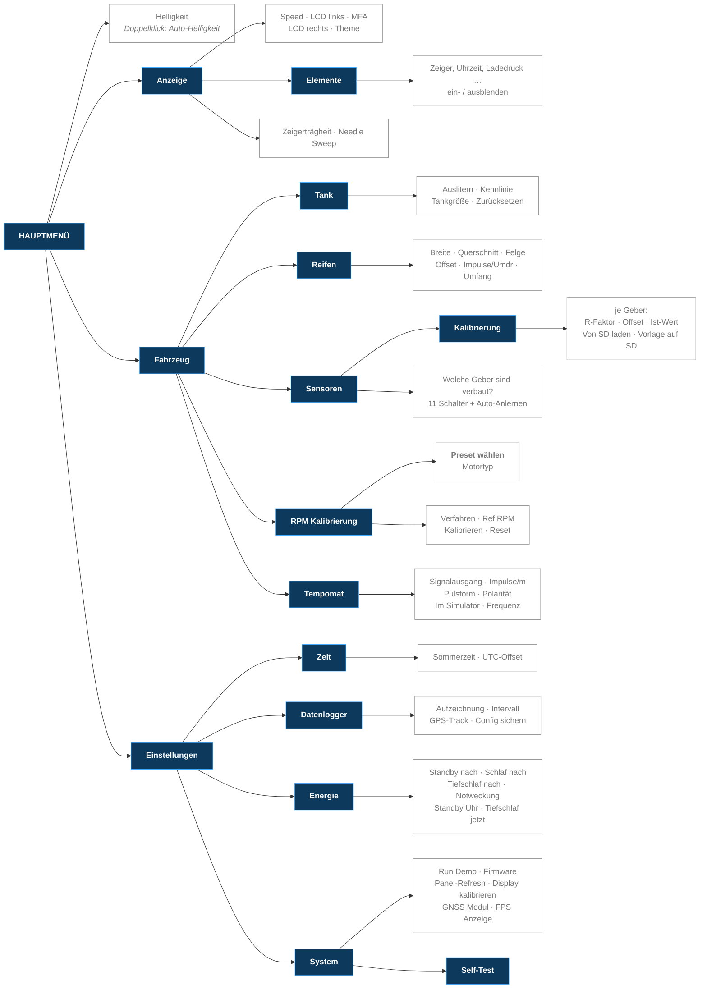

# Das Bedien-Menü

Übersicht über alle Menüpunkte der Firmware **v1.4.0 (Beta)**.

Bedient wird alles über den **Dreh-Encoder**.

---

## Bedienung ohne Menü

Seit v1.4.0 verstellst du die wichtigsten Anzeigen direkt am Encoder, ohne ins
Menü zu gehen.

| Eingabe | Wirkung |
|---|---|
| **Drehen** | Inhalt des aktiven Anzeigefelds weiterschalten. Standard ist auf Screen 1 das Mittel-LCD (MFA), auf Screen 3 der linke Werteblock |
| **Kurz drücken** | Feldauswahl öffnen. Drehen wandert zwischen den Feldern, drücken bestätigt. Das gewählte Feld blinkt |
| **Doppelklick** | Fertig – zurück aufs Standardfeld. Zeigt das Mittel-LCD den Tageskilometer, setzt der Doppelklick ihn auf 0 |
| **Drücken + Drehen** | Screen wechseln |
| **Lang drücken** | Menü öffnen (beim Loslassen) |

- Nach 8 Sekunden ohne Eingabe springt die Auswahl von selbst aufs Standardfeld zurück.
- Zeigt das Mittel-LCD eine **Warnung**, quittiert die nächste Eingabe sie zuerst.
- Felder, die im Menü ausgeschaltet sind, lassen sich nicht anwählen.

---

## Bedienung im Menü

| Eingabe | Wirkung |
|---|---|
| **Drehen** | Zeile wechseln |
| **Kurz drücken** | Auswählen / Untermenü öffnen / Schalter umlegen |
| **Doppelklick** | Nur bei Zeilen mit Doppelpfeil `»`: öffnet das Untermenü dahinter |
| **Lang drücken** | Menü sofort komplett schließen |

Bei Punkten mit mehreren Werten (z. B. Helligkeit) drückst du **einmal** –
die Zeile wird **grün**. Jetzt änderst du mit dem Drehen den Wert. Noch einmal
drücken übernimmt ihn.

Die unterste Zeile ist immer **„Zurueck"**. Im Hauptmenü schließt sie das Menü,
sonst geht es eine Ebene hoch – und zwar genau auf den Punkt, von dem du
gekommen bist.

Das Menü öffnet immer auf **Helligkeit**. Was man öfter braucht, steht in jeder
Ebene oben. Nur die Sensoren-Liste ist länger als das Display – dort erscheint
rechts eine **Bildlaufleiste**.

---

## Der Menübaum

**Fahrzeug** fasst alles zusammen, was du einmal an dein Auto anpasst.
**Einstellungen** betrifft das Gerät selbst. Beide enthalten nur Untermenüs.

---

## Hauptmenü

| Punkt | Bedeutung |
|---|---|
| **Helligkeit** | 5 – 100 % (Stufen: 5, 10, 20, 30, 40, 60, 80, 100). Mit Auto-Helligkeit verstellst du hier die Tendenz (heller/dunkler). **Doppelklick** öffnet die Einstellungen der Auto-Helligkeit |
| **Anzeige** | Was auf dem Display zu sehen ist |
| **Fahrzeug** | Anpassung an dein Auto |
| **Einstellungen** | Das Gerät selbst |
| **Zurueck** | Menü schließen |

---

## Anzeige

Die Liste gehört zu dem Screen, auf dem du gerade bist. Oben stehen die Dinge,
die man öfter umstellt – auf beiden Screens in derselben Reihenfolge.

| Punkt | Screen | Bedeutung |
|---|---|---|
| **Geschwindigkeit** / **Speed** | 1 / 3 | Woher die Geschwindigkeit kommt (Auswahl siehe unten) |
| **LCD links** | 1 und 3 | Kurz drücken: Block **ein/aus**. **Doppelklick:** was in den beiden Zeilen steht |
| **MFA** | 1 | Kurz drücken: Mittel-LCD **ein/aus**. **Doppelklick:** welche Inhalte beim Drehen vorkommen |
| **LCD rechts** | 1 und 3 | wie LCD links |
| **Theme** | 1 | Bildsatz für Screen 1, siehe [README](README.md#themes-auf-die-sd-karte) |
| **Elemente** | 1 und 3 | Untermenü: einzelne Anzeigen ein- und ausblenden |
| **Zeigerträgheit** | alle | Wie schnell die Zeiger einem Wert folgen: `Traege` · `Normal` · `Direkt` · `Snappy` |
| **Needle Sweep** | alle | Der Begrüßungs-Zeigerlauf beim Einschalten |

### LCD-Zeilen

Jeder Werteblock hat zwei Zeilen (**Oben** / **Unten**). Jede Zeile zeigt einen
Wert deiner Wahl:

`Aus` · `Aussentemp` · `Wasser` · `Oeltemp` · `Oeldruck` · `Batterie` · `Ladeluft` · `Ladedruck`

Ist eine Zeile aus, rückt die andere nach oben. Ohne Menü schaltest du die Zeile
einfach per Drehen weiter – `Aus` gibt es nur hier im Menü.

> Screen 1 und Screen 3 haben **eigene Einstellungen**. Was du auf Screen 1
> wählst, gilt nicht automatisch auf Screen 3.

### MFA (Mittel-LCD, nur Screen 1)

Inhalte: `Tageskilometer` · `Bordspannung` · `Tankinhalt (Liter)` ·
`Rad Geschwindigkeit` · `GPS Geschwindigkeit` · `GPS Hoehe` ·
`Ladedruck Balken` · `Uhrzeit`

Im Untermenü schaltest du ein, welche davon beim Drehen vorkommen. Einer bleibt
immer an – wer die MFA ganz weg haben will, schaltet sie in **Anzeige** aus.

> **Warnungen erscheinen auch bei ausgeschalteter MFA** im Mittel-LCD –
> Öldruck & Co. sollen nicht unbemerkt bleiben.

`Tankinhalt (Liter)` braucht eine ausgeliterte Tank-Kennlinie
(**Fahrzeug → Tank → Auslitern**), sonst steht dort `---L`.

### Geschwindigkeit

| Screen | Auswahl |
|---|---|
| **1** | `Aus` · `Rad km/h` · `Rad km/h (b)` · `GPS km/h` · `Beide` |
| **3** | `Rad km/h` · `GPS km/h` · `Beide` · `Aus` |

`Rad km/h (b)` blendet zusätzlich die dunklen Segmente hinter den Ziffern ein,
wie bei einer echten Siebensegmentanzeige. Bei `Beide` steht groß das
Radsignal und klein darüber der GPS-Wert.

### Anzeige → Elemente

| Screen | Was du ein-/ausschalten kannst |
|---|---|
| **Screen 1** | Drehzahl Zeiger · Ladedruck · Uhrzeit |
| **Screen 3** | Drehzahl Zeiger · Drehzahl Bogen · Ladedruck · Ladeluft Temp · Tageskilometerzähler · Uhrzeit |

**Drehzahl Bogen** (Screen 3) ist eine Auswahl: `Aus` · `Zeiger` (wandert mit) ·
`Voll` (fest auf 100 %).

> **Kühlwasser- und Tankzeiger stehen nicht in der Liste.** Sie sind
> Pflichtanzeigen und werden immer angezeigt.

---

## Fahrzeug → Tank

| Punkt | Bedeutung |
|---|---|
| **Auslitern** | Assistent: Tank in Schritten befüllen und die Werte aufnehmen |
| **Kennlinie** | Kennlinie des Tankgebers von Hand einstellen |
| **Tankgroesse** | Fassungsvermögen in Litern |
| **Zuruecksetzen** | Kalibrierung verwerfen |

---

## Fahrzeug → Reifen

Damit der Tacho stimmt, muss die Firmware den Abrollumfang kennen.

| Punkt | Bedeutung |
|---|---|
| **Breite** | 155 – 305 mm |
| **Querschnitt** | 30 – 85 % |
| **Felge** | 13 – 20 Zoll |
| **Offset** | Feintrimm −10,0 … +10,0 % |
| **Impulse/Umdr** | 1 – 16. Wie viele Magnete pro Radumdrehung am Geber vorbeikommen |
| **Umfang** | Nur Anzeige – rechnet beim Drehen live mit |

Kontrollwert: **225/55 R16 → 2054 mm**.

> **So findest du Impulse/Umdr:** im Debug-Screen die Rohfrequenz ablesen und
> daneben die GPS-Geschwindigkeit. `Frequenz × 3600 ÷ km/h` ergibt die Impulse
> pro Kilometer – der Sollwert steht im Protokoll gleich daneben. Kommt nur die
> Hälfte heraus, sind es halb so viele Magnete wie eingestellt.

> Wird die Umfang-Zeile **rot**, passt die Kombination nicht zusammen und die
> Firmware rechnet ersatzweise mit dem Standardwert. Einfach zurückdrehen.

**Nach dem Einstellen einmal gegen GPS gegenprüfen** und die Abweichung über
`Offset` ausgleichen.

---

## Fahrzeug → Sensoren

Hier sagst du der Firmware, **welche Geber bei dir tatsächlich verbaut sind**.
Ein ausgeschalteter Geber wird nicht ausgewertet und erzeugt keine Warnung.

| Punkt | Bedeutung |
|---|---|
| **Kalibrierung** | Untermenü, siehe unten |
| Kühlwasser · Öltemperatur · Ansaug vor LLK · Ansaug nach LLK · Außentemperatur | Temperatur-Geber verbaut ja/nein |
| Ladedruck · Öldruck · Öldr.-Sch. 0,3 · Öldr.-Sch. 0,9 | Druck-Geber und -Schalter verbaut ja/nein |
| **Oeldr.-Sch. ab** | Ab welcher Drehzahl der obere Öldruckschalter ausgewertet wird: `1500` · `1800` · `2000` · `2500`. VW verwendet je nach Modell 1500 oder 2000/min |
| Tank · Radsensor (Hall) | Geber verbaut ja/nein |
| **Auto-Anlernen** | Die Firmware prüft selbst, welche Geber angeschlossen sind, und setzt die Schalter passend |

### Sensoren → Kalibrierung

Gleicht die Streuung der Geber aus. NTC-Geber haben ±15 % Toleranz – beim
Kühlwasser sind das bei echten 80 °C rund **9 Grad** Unterschied von Geber zu
Geber.

Je Geber (Kühlwasser · Öltemperatur · Ansaug vor/nach LLK · Öldruck):

| Punkt | Bedeutung |
|---|---|
| **Quelle** | Woher die Kennlinie kommt: `Werk` · `NVS` (im Gerät gespeichert) · `SD` |
| **R-Faktor** | 0,80 – 1,25 – der eigentliche Abgleich |
| **Offset** | ±10 Grad (Öldruck ±0,5 bar) für den Restfehler |
| **Ist-Wert** | Der aktuelle Messwert, live |
| **Auf Werk zurück** | Kennlinie und Abgleich dieses Gebers verwerfen |

**So gleichst du ab:** Geber in kochendes Wasser, dann den `R-Faktor` drehen,
bis der `Ist-Wert` auf 100 °C steht. **Ein Messpunkt genügt** – der Faktor zieht
die Kennlinie über den ganzen Temperaturbereich richtig.

Darunter, für alle Geber zusammen:

| Punkt | Bedeutung |
|---|---|
| **Von SD laden** | Kennlinien aus `/sdcard/cfg/sensor_cal.ini` übernehmen |
| **Vorlage auf SD** | Die aktuell aktiven Kurven als Datei zurückschreiben |
| **Alle auf Werk** | Alles verwerfen |

> Fehlt die Datei auf der Karte, legt die Firmware beim Start selbst eine
> kommentierte Vorlage an. Punkt **und** Komma sind als Dezimaltrenner erlaubt,
> die Reihenfolge der Messpunkte ist egal.

---

## Fahrzeug → RPM Kalibrierung

Damit die Drehzahl stimmt, muss die Firmware wissen, wie viele Impulse dein
Motor pro Umdrehung liefert.

| Punkt | Bedeutung |
|---|---|
| **Preset wählen** | Motortyp vorgeben: `Diesel JX/AAZ`, `Benz 4-Zyl`, `Benz 5-Zyl`, `Benz 6-Zyl`, `Custom / ECU` oder `Manuell` (frei einstellbar) |
| **Verfahren** | Messverfahren der Drehzahl |
| **Ref RPM** | Referenz-Drehzahl fürs Kalibrieren (Leerlauf, z. B. 840) |
| **Kalibrieren** | Motor auf die Referenz-Drehzahl bringen, dann diesen Punkt drücken |
| **Reset** | Kalibrierung verwerfen |

---

## Fahrzeug → Tempomat

Der Geschwindigkeits-Ausgang zum Steuergerät (VSS).

| Punkt | Bedeutung |
|---|---|
| **Signalausgang** | Hauptschalter. Aus = am Ausgang passiert nichts |
| **Impulse/m** | Kennwert des Steuergeräts: 1 · 2 · **4** · 6 · 8 · 16, zusätzlich als `/km` angezeigt |
| **Pulsform** | Form des Signals: **50 %** · 25 % · 75 % · 1 ms · 2 ms. Ändert nur die Form, nicht die Frequenz |
| **Polarität** | **Normal** / Invertiert: dreht das Signal um (im Stand High oder Low) |
| **Im Simulator** | Darf die Demo den Ausgang treiben? Aus = am Schreibtisch bleibt er still |
| **Frequenz** | Nur Anzeige: was **wirklich** am Ausgang anliegt. `---` = es geht nichts raus |

> **Pulsform und Polarität sind zur Fehlersuche gedacht.** Standard bleibt
> 50 % / Normal – nur ändern, wenn der Tempomat das Signal nicht annimmt.

Einen Feintrimm gibt es hier bewusst nicht: die einzige verbleibende
Fehlerquelle ist die Geschwindigkeitsberechnung, und die wird unter
**Fahrzeug → Reifen → Offset** getrimmt.

---

## Einstellungen → Zeit

| Punkt | Bedeutung |
|---|---|
| **Sommerzeit** | Eine Stunde dazu |
| **UTC-Offset** | Zeitzone (Deutschland Winter: `+1`) |

Die Uhrzeit selbst kommt vom GPS.

---

## Einstellungen → Datenlogger

| Punkt | Bedeutung |
|---|---|
| **Aufzeichnung** | Messwerte auf die SD-Karte schreiben |
| **Intervall** | Wie oft aufgezeichnet wird (in 10-Sekunden-Schritten) |
| **GPS-Track** | Zusätzlich die gefahrene Strecke aufzeichnen |
| **Config sichern** | Schreibt **alle** Einstellungen des Geräts als lesbare Datei nach `/sdcard/cfg/vedo_config.ini`. Das Ergebnis steht direkt hinter dem Menüpunkt (`OK` / `KEINE SD` / `FEHLER`) |

---

## Einstellungen → Energie

| Punkt | Bedeutung |
|---|---|
| **Standby nach** | Nach dieser Zeit ohne Bedienung springt das Gerät auf die Standby-Uhr (30 s bis 30 min, oder `Aus`) |
| **Schlaf nach** | Nach dieser Zeit geht das Display aus (30 s bis 60 min, oder `Aus`) |
| **Tiefschlaf nach** | Nach dieser Zeit im Schlaf geht das Gerät ganz aus (1 min bis 12 h, oder `Aus`). Ab Werk **Aus** |
| **Notweckung** | Sicherheitstimer, der das Gerät aus dem Tiefschlaf zurückholt (`Aus` · 1 min · 5 min · 15 min · 1 h · 12 h). Ab Werk 1 min |
| **Standby Uhr** | Springt sofort zur Standby-Uhr |
| **Tiefschlaf jetzt** | Sofort in den Tiefschlaf |

> Die Zeiten **addieren sich**: „Schlaf nach" zählt ab der letzten Bedienung,
> „Tiefschlaf nach" erst ab dem Einschlafen.

> ⚠️ Rot dargestellte Einträge sind die scharfen: `Tiefschlaf nach` alles außer
> `Aus`, und `Notweckung` auf `Aus`. **Beides zusammen** heißt, dass das Gerät
> nur noch über die Weckleitung zurückkommt.

---

## Einstellungen → System

Werkzeuge für Diagnose und Service – im Alltag brauchst du die nicht.

| Punkt | Bedeutung |
|---|---|
| **Run Demo** | Simulierte Fahrt, um die Anzeigen ohne laufenden Motor zu prüfen: `Aus` · `Stadt` · `Ueberland` · `Autobahn` · `Vollgas` |
| **Firmware** | Sucht sofort auf der SD-Karte nach einer Firmware und spielt sie auf, ohne auf den nächsten Neustart zu warten. Auch derselbe Stand lässt sich damit noch einmal schreiben. Versionen vor 1.3.0 bleiben auch hier gesperrt |
| **Self-Test** | Siehe unten |
| **Panel-Refresh** | Treibt **Nachleuchten** (Image Sticking) aus dem Display, wenn ein Standbild sich eingebrannt hat |
| **Display kalibrieren** | Bildlage des Displays einstellen |
| **GNSS Modul** | Welches GPS-Modul verbaut ist: **LC76G** oder **SR1612U10** (u-blox M10). Wirkt nach dem nächsten Neustart – bis dahin steht `NEUSTART` hinter der Zeile |
| **FPS Anzeige** | Blendet die Bildrate auf den Cluster-Screens ein (grün ab 20, gelb ab 10, darunter rot) |

> Der Demo-Zyklus lässt sich im laufenden Betrieb wechseln. Temperaturen,
> Tankinhalt und Trip bleiben dabei stehen, es ändert sich nur das Fahrverhalten.
> `Vollgas` ist ausdrücklich keine realistische Fahrt, sondern eine Vorführung.

### System → Self-Test

| Punkt | Bedeutung |
|---|---|
| **Bei Start** | Selbsttest bei jedem Einschalten ausführen |
| **Manueller Start** | Selbsttest jetzt sofort ausführen |

---

## Wo finde ich die Version?

Im **Boot-Screen** und **unten im Menü** – dort steht immer die laufende
Firmware-Version.
